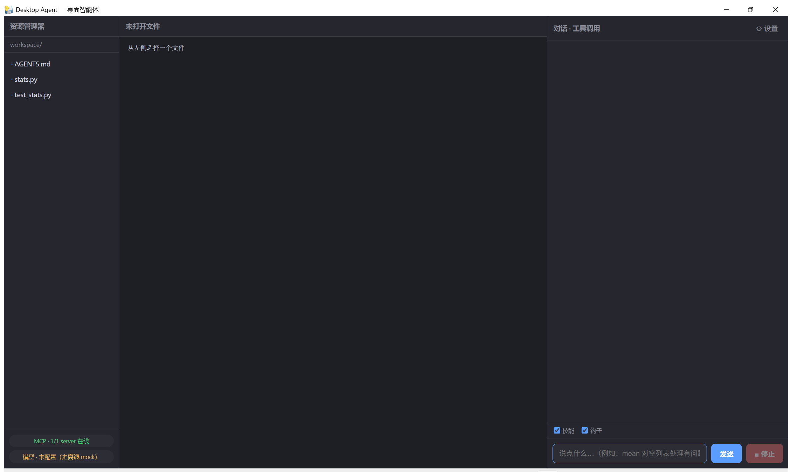
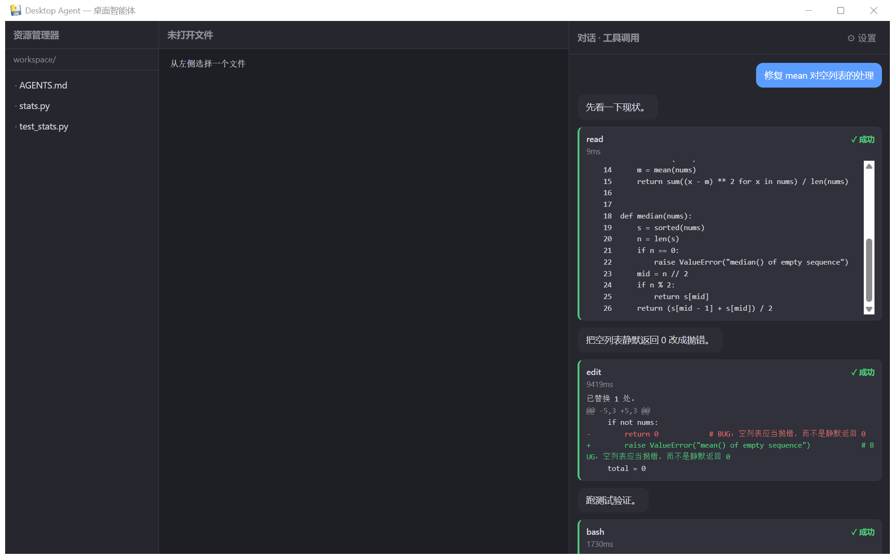
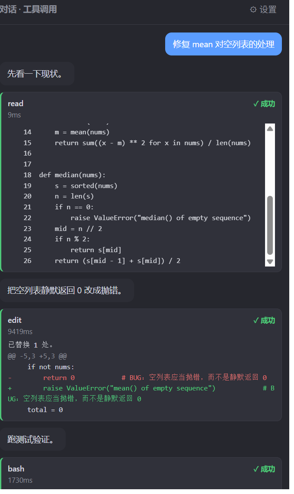

# Desktop Agent：桌面智能体课程作业

## 1. 项目简介

Desktop Agent 是一个基于 Python、pywebview 和 DeepSeek 模型接口开发的桌面智能体课程项目，双击即出窗口（有标题栏的桌面应用，不是 localhost 网页）。

项目将大语言模型与本地工具结合，智能体按「决策 → 动作 → 观察 → 再决策」循环工作，工具调用全程可见、可中断。

## 界面截图

| 主界面（三栏） | 工具调用过程 | 工具卡片特写 |
|---|---|---|
|  |  |  |

图 2 是一次真实运行：`read` 带行号回显 → `edit` 红绿 diff → `bash` 跑测试，全程在对话栏可见。

## 2. 主要功能

### 2.1 桌面交互界面

- 三栏布局：左侧资源浏览、中间代码查看（带行号）、右侧对话与工具调用
- 工具调用逐条展示（含 diff 绿加红减、失败标红）
- 随时中断正在运行的任务；API Key 通过界面设置，不经过前端存储

### 2.2 DeepSeek 模型接入

通过 OpenAI 兼容接口流式调用 DeepSeek 模型。未配置 Key 时自动切换离线 mock，仍可走完整循环（演示与 CI 均不依赖网络）。

### 2.3 本地工具

| 工具 | 功能 |
|---|---|
| `read` | 按行读取工作区文件，大文件自动分页，图片走多模态块 |
| `write` | 覆盖写入，自动建父目录，临时文件 + rename 原子写 |
| `edit` | 精确字符串替换，old 不唯一时拒绝并列出行号，返回最小 diff |
| `bash` | 在工作区执行命令，返回 stdout/stderr/exit_code，超时杀进程树 |

### 2.4 技能系统（渐进披露）

`skills/` 下每个技能一个文件夹，`SKILL.md` 的 YAML 头写 `name` + `description`（含触发语）。

- 启动时**只注入目录**（名字 + 一句话描述），正文不进上下文
- 模型判断命中后调 `use_skill(name)`，正文才注入
- 三种形态都有实例：纯提示词（`run-tests`）、带脚本（`review-diff` + `scripts/collect_diff.py`）、
  走 MCP（`fetch-issue` + `mcp__demo__issue_get`）
- 目录 181 token，全文 1407 token，比值 7.8（`skill_report.json`）

### 2.5 定制层

- **AGENTS.md 两层注入**：全局（`~/.desktop-tutorial/AGENTS.md`）+ 项目（工作区往上找最近一份），
  内容是「地图」不是文档：路径→职责、命令→怎么跑、坑→别踩
- **三个 hook（代码级）**：写 `.env`/`*.pem`/`*.key` 拒绝；`rm -rf`、`git push --force`、
  `git reset --hard` 拒绝并给替代方案；write/edit 之后自动跑测试，只回注三行失败摘要
- **reviewer 子 agent**：只读工具 + 五条固定清单，只回最后一条结论
  （实测 `subagent_tokens=329`，主上下文只增加 56）

### 2.6 MCP 工具调用

已实现真实 MCP 客户端（stdio JSON-RPC）：自动启动 `mcp.json` 中配置的 server，
发现其工具并以 `mcp__server__tool` 命名合并进注册表。仓库自带一个最小
MCP server（`workspace_stats` / `note_add`）作为集成示例。

### 2.7 常驻能力（选做增量 C）

- **崩溃续跑**：每一步 turn 落盘 checkpoint（原子写），进程被 `kill -9` 后 `resume` 从断点继续，
  已执行过的工具调用不会重放（`executed_calls` 幂等）
- **定时触发**：`routines.yaml`（`every_seconds` / `at`），到点跑一个 skill
- **事件触发**：轮询目录变化进队列（标准库实现，不引 watchdog）
- **完成通知**：Windows toast + 日志双通道

```bash
python -m app.inspect daemon --out daemon_report.json
```

## 3. 安全机制

1. **工作区路径限制**：所有文件操作校验路径，拒绝越出工作区。
2. **edit 前必须 read**：本会话没读过的文件拒绝修改，杜绝基于臆测的编辑；
   替换目标出现多次时同样拒绝并列出行号，绝不猜测。
3. **bash 超时**：默认 20 秒（上限 120），超时连同进程树一起终止。
4. **循环护栏**：步数上限、token 预算、同一调用连续 3 次判定兜圈子并叫停。
5. **中断**：工具执行与模型调用均可被用户中断。
6. **密钥保护**：API Key 只保存在用户目录（`~/.desktop-tutorial/config.json`），
   任何接口只返回掩码；`.gitignore` 排除 `.env`、`dist` 等敏感内容。
7. **hook 兜底**：即使模型被提示词说动，PreToolUse 也会在代码层拒绝写密钥文件与破坏性命令。
8. **写完就验**：PostToolUse 在每次 write/edit 后自动跑测试，红了只回三行，逼模型面对证据。

## 4. 环境要求

- 操作系统：Windows
- Python：3.12+（开发环境 3.12）
- 桌面界面：pywebview（内置 Edge WebView2）
- 模型接口：DeepSeek OpenAI 兼容接口

## 5. 安装依赖

在项目根目录运行：

```bash
python -m pip install -r requirements.txt
```

## 6. 配置 DeepSeek 模型

两种方式任选：

- **界面配置（推荐）**：启动后点右上角 ⚙ 设置，粘贴 API Key 保存。
- **环境变量**：参考 `.env.example`，设置 `DEEPSEEK_API_KEY`、
  `DEEPSEEK_BASE_URL`、`DEEPSEEK_MODEL` 后启动。

**安全提示：不要将 API Key 或 `.env` 上传到 GitHub。** Key 只保存在本地用户目录，任何接口都不会明文回传。

## 7. 启动桌面应用

```bash
python app.py
```

无需界面时也可用命令行运行同一智能体：

```bash
python cli.py --offline "修复 mean 对空列表的处理"
```

## 8. 运行自动化测试

```bash
python -m pytest tests -q
```

共 45 项断言，覆盖文件读写、edit 唯一性检查、bash 超时、循环护栏（步数/预算/兜圈子/中断）、
MCP 协议交互、配置层密钥不泄露及 server 接口行为。每次 push 由 GitHub Actions 自动执行。

## 9. 验收命令（作业：数字必须由程序打印）

```bash
python -m app.inspect skills --out skill_report.json
python -m app.inspect custom --out custom_report.json
python -m app.inspect daemon --out daemon_report.json   # 选做
```

- `skill_report.json`：技能清单、目录/全文 token、`disclosure_ratio`、8 条触发试验、误触发数
- `custom_report.json`：AGENTS.md 层数与字节、被 hook 拒绝的尝试、自动测试红绿统计、
  reviewer 的问题数与上下文增量
- `daemon_report.json`：定时/事件触发次数、`resume_from_step`（证明不是从第 1 步重来）、
  `notify_fired`、`idempotent` 与 `replayed_tools`

### 9.1 常驻演示：kill -9 之后从第 3 步继续

```powershell
# 终端 A：跑一个 5 步的长任务（--slow 只是留出 kill 的窗口）
python -m agent.daemon run --task "修复 mean 对空列表的处理" --run-id demo --slow 0.8 --reset

# 终端 B：等它报完 [step 3] 后直接杀（Windows 的 TerminateProcess，没有清理机会）
Stop-Process -Id <python 的 pid> -Force

# 终端 A：从断点续跑，输出里能看到 resume_from_step
python -m agent.daemon resume --run-id demo
```

实测：杀在 `step=2`、已执行 1 个调用；续跑 `resume_from_step=3`，补完剩下 4 个调用，
5 个调用一个没重放；第二次 `resume` 命中 `done` 直接跳过。

## 10. 能力开关

| 环境变量 | 作用 | 关掉后的现象 |
|---|---|---|
| `ENABLE_SKILLS=0` | 不加载技能 | 工具表少 `use_skill`，system prompt 里没有技能目录 |
| `ENABLE_HOOKS=0` | 不装 hook | 不再拦 `.env`/`rm -rf`，写完也不自动跑测试 |
| `ENABLE_SUBAGENT=0` | 不注册 reviewer | 工具表少 `spawn_reviewer` |

界面上也有「技能 / 钩子」两个勾选框，可以直接对比开关前后的工具调用轮数。

## 11. 打包

```bash
pyinstaller --noconfirm --onefile --windowed --name DesktopAgent ^
  --add-data "ui;ui" --add-data "workspace;workspace" --add-data "mcp.json;." app.py
```

产出 `dist/DesktopAgent.exe`，双击出窗口。详细步骤与踩坑见 [docs/build.md](docs/build.md)。

## 12. 项目目录结构

```text
desktop-tutorial/
├── app.py              # pywebview 桌面应用入口
├── cli.py              # 命令行入口（与桌面共用同一智能体循环）
├── AGENTS.md           # 项目地图（注入 system prompt 的项目层）
├── report.md           # 报告：技能 / 定制 / 取舍
├── agent/              # 循环、四个工具、技能系统、hooks、子 agent、验收命令
│   └── daemon/         # 常驻：checkpoint 续跑 / routines 定时 / watch 事件 / notify
├── app/                # 验收命令兼容入口（python -m app.inspect）
├── skills/             # 技能目录：run-tests / review-diff / fetch-issue
├── routines.yaml       # 定时触发表（到点跑哪个 skill）
├── server/             # FastAPI 后端（SSE 事件流）
├── ui/                 # 三栏界面（含技能 / 钩子开关）
├── mcp/                # MCP 客户端与示例 server（含 issue 工具）
├── workspace/          # 演示工作区（stats.py 故意留了一个 bug）
├── tests/              # 自动化测试（82 项）
├── docs/               # 运行记录 / 打包说明 / 全局 AGENTS.md / 样例 diff
├── skill_report.json   # 技能验收报告（程序打印）
├── custom_report.json  # 定制层验收报告（程序打印）
├── daemon_report.json  # 常驻验收报告（选做，程序打印）
└── mcp.json            # MCP server 配置
```

## 13. 项目当前状态与后续改进

- **v1.0**：桌面窗口、四工具、MCP、安装包
- **v1.1**：技能系统（渐进披露 + 三种形态 + 触发试验）
- **v1.2**：定制层（AGENTS.md 两层、三个 hook、reviewer 子 agent、界面开关）
- **v1.3**：常驻（checkpoint 续跑 + routines 定时 + 目录事件 + 通知，选做增量 C）

未做：多机分布式队列、系统托盘常驻、cron 全语法。当前 `routines.yaml` 只支持
`every_seconds` 与每日 `at` 两种写法 —— 够覆盖「定时跑 skill」的需求，不值得为 cron 引依赖。

## 14. 课程项目说明

本项目用于展示桌面智能体的基础架构设计、模型接口接入、本地工具封装、
MCP 协议集成、工具调用安全控制和自动化测试等内容。
